# ☁️ Agricultura Ecológica en España – Pipeline en Azure

Versión en la nube del proyecto [**Agricultura Ecológica en España (2012-2024)**](https://github.com/SamAnaya11):
el mismo análisis con datos de **Eurostat**, pero ahora el pipeline funciona **solo en Azure**. Cada mes
descarga los datos, los guarda, los limpia y los carga en una base de datos en la nube, **sin intervención manual**.

## 📌 Estado del proyecto

| Fase | Contenido | Estado |
|---|---|---|
| 0 | Análisis del original, migración SQLite → T-SQL, presupuesto de 5 € | ✅ Completada |
| 1 | Infraestructura con Bicep + Function mensual y manual + carga en Azure SQL | ✅ Completada |
| 2 | Despliegue automático con GitHub Actions (OIDC) | 🔜 Pendiente |
| 3 | Seguridad (identidad administrada / Key Vault) y alerta si falla la Function | 🔜 Opcional |

**Primera ejecución en Azure (09/11/2026):** 28 países, 17 cultivos, 13.529 filas de superficie, 620 de % SAU,
2.015 de operadores y 1.395 de ganadería. Son las mismas cifras que el proyecto original.

---

## 🎯 Objetivo

| Proyecto original (local) | Este proyecto (Azure) |
|---|---|
| Se ejecuta a mano con `python main.py` | Se ejecuta solo el **día 1 de cada mes** |
| Archivos en `data/raw/` y `data/processed/` | Contenedores `raw/` y `processed/` en **Blob Storage**, con histórico por fecha |
| Base de datos **SQLite** (un archivo `.db`) | **Azure SQL Database** (mismo modelo en estrella) |
| Consultas desde el notebook | Consultas desde el **portal** (Query editor) o desde un notebook |

## 🏗️ Arquitectura

```
 Temporizador mensual ─┐
 (o petición POST) ────┴─> Azure Function (Python) ──> API Eurostat
                                   │
                                   ├──> Blob Storage   raw/AAAA-MM-DD/*.tsv
                                   ├──> Blob Storage   processed/AAAA-MM-DD/*.csv
                                   └──> Azure SQL Database (modelo en estrella)
                                                │
                                                └──> consultas de análisis (portal / notebook)
```

Diagrama detallado, regiones y convención de nombres: [`docs/arquitectura.md`](docs/arquitectura.md).

## 🧰 Servicios de Azure

| Servicio | Región | Para qué | Por qué este |
|---|---|---|---|
| **Azure Functions** (Flex Consumption, Python 3.14) | Spain Central | Ejecuta el pipeline | Plan de consumo **recomendado por Microsoft**; se paga por uso y tiene cuota gratuita mensual |
| **Blob Storage** (Standard LRS) | Spain Central | Guarda los datos originales y limpios | La opción de almacenamiento más barata |
| **Azure SQL Database** (oferta gratuita, serverless) | **France Central** | Modelo en estrella y consultas | Gratis para siempre (100.000 vCore·s y 32 GB al mes) y habla T-SQL |
| **Application Insights** + Log Analytics | Spain Central | Logs y errores de la Function | Integrado con Functions; 5 GB/mes gratis |
| **Cost Management** (presupuesto) | Suscripción | Aviso por correo si el gasto pasa de 5 € | Gratis |

## 🚀 Despliegue paso a paso

**Requisitos:** una suscripción de Azure, [Azure CLI](https://learn.microsoft.com/cli/azure/install-azure-cli)
(incluye Bicep) y Python 3.11 o superior. Los comandos son de PowerShell; en Linux/macOS hay scripts `.sh` equivalentes.

**1. Iniciar sesión**

```powershell
az login
```

**2. Crear el presupuesto de 5 €** (gratis). Hazlo antes que cualquier otro recurso:

```powershell
az deployment sub create --name presupuesto-agroeco --location spaincentral `
  --template-file infra/presupuesto.bicep --parameters correoAviso=<tu correo>
```

**3. Vista previa** (what-if). No crea nada, solo muestra qué se va a crear:

```powershell
$MiIp = Invoke-RestMethod https://api.ipify.org     # tu IP pública, para el firewall de SQL
.\scripts\desplegar.ps1 -VistaPrevia -IpCliente $MiIp
```

**4. Desplegar** la infraestructura y el código (unos 10 minutos). Azure CLI te pide la contraseña del
administrador SQL, que no se guarda en ningún archivo:

```powershell
.\scripts\desplegar.ps1 -IpCliente $MiIp
```

Si solo cambias código de Python, basta con `.\scripts\desplegar.ps1 -SoloCodigo`.

**5. Ejecutar el pipeline** sin esperar al día 1 del mes:

```powershell
.\scripts\ejecutar_manual.ps1
```

**6. Comprobarlo en el portal:**

| Dónde | Qué ver |
|---|---|
| Resource groups → `rg-agroeco-dev` | Los 8 recursos |
| Function App → Overview → Functions | `pipeline_mensual` (Timer) y `pipeline_manual` (HTTP) |
| Storage account → Containers → `raw` / `processed` | Una carpeta por fecha de ejecución |
| SQL database → Query editor (preview) | Las consultas de `sql/02_consultas_analisis.sql` |
| Application Insights → Logs | Los mensajes del pipeline (tabla `traces`) |

### ▶️ Ejecutar manualmente

El script hace esto (solo lee datos de Azure; no crea nada):

```powershell
$App   = az deployment sub show --name agroeco-dev --query properties.outputs.functionApp.value -o tsv
# Flex Consumption: el host está en "properties.defaultHostName" (el campo de primer nivel sale vacío)
$Host_ = az functionapp show -g rg-agroeco-dev -n $App --query properties.defaultHostName -o tsv
$Clave = az functionapp function keys list -g rg-agroeco-dev -n $App --function-name pipeline_manual --query default -o tsv
Invoke-RestMethod -Method Post -Uri "https://$Host_/api/ejecutar?code=$Clave" -TimeoutSec 300
```

También vale el **Default domain** que muestra el portal (Function App → Overview).

⚠️ **OneDrive:** crea el entorno virtual **fuera** de OneDrive (por ejemplo en `%LOCALAPPDATA%\venvs\agroeco`).

## 💶 Costes estimados

| Recurso | Coste mensual estimado |
|---|---:|
| Function App (Flex Consumption) | 0 € (dentro de la cuota gratuita) |
| Azure SQL Database (oferta gratuita, AutoPause) | 0 € |
| Storage Account (pocos MB) | < 0,01 € |
| Application Insights / Log Analytics | 0 € (tope de 0,1 GB/día) |
| Tráfico Spain Central → France Central (~2 MB) | ≈ 0 € |
| **Total** | **≈ 0 €** (céntimos) |

## 🗑️ Borrarlo todo

```powershell
.\scripts\borrar_todo.ps1
```

Pide confirmación y elimina el grupo de recursos completo. El presupuesto (gratis) se mantiene.

## 🧠 Decisiones técnicas

### 1. Azure SQL en France Central (y el resto en Spain Central)

Todo el proyecto está en **Spain Central** (la región más cercana), salvo el **servidor y la base de datos SQL**,
que están en **France Central**.

**Por qué:** la oferta gratuita de Azure SQL Database **no está disponible en Spain Central para esta
suscripción de prueba** (*Free Trial*). Al desplegar, Azure respondía:

```
ProvisioningDisabled: Provisioning of free limit database is not supported
for provided service level objective or region
```

**Cómo se comprobó:** el error se repetía con cualquier forma de escribir el SKU, así que se consultó la API de
capacidades de Azure SQL de cada región (solo lectura). En Spain Central el SKU serverless `GP_S_Gen5_2` está
disponible **de pago**, pero sin la opción de límite gratuito (`supportedFreeLimitExhaustionBehaviors`):

| Región | ¿Se puede crear SQL? | ¿Oferta gratuita? |
|---|---|---|
| Spain Central | ✅ | ❌ |
| **France Central** | ✅ | ✅ ← elegida (la más cercana) |
| Sweden Central, Germany West Central, Italy North, Poland Central | ✅ | ✅ |
| North Europe, West Europe | ⛔ restringidas para esta suscripción | — |

**Qué implica:**
- El servidor SQL y su base de datos tienen que estar **en la misma región**; por eso los dos usan el
  parámetro `ubicacionSql` del Bicep.
- La Function (España) se conecta a la base de datos (Francia): unos 20-30 ms más por consulta, inapreciable
  en una carga mensual de ~17.600 filas.
- El tráfico entre regiones es de unos pocos MB al mes: coste prácticamente nulo.
- Si en el futuro la oferta gratuita llega a Spain Central, basta con cambiar `ubicacionSql` en
  `infra/main.parameters.example.json` (habría que borrar y recrear el servidor SQL).

### 2. SQLite → Azure SQL Database (T-SQL)

| | SQLite (original) | Azure SQL Database |
|---|---|---|
| Dónde vive | Un archivo `.db` en el ordenador | Un servidor en la nube |
| Acceso | Solo desde ese ordenador | Desde la Function, el portal o un notebook |
| Coste | Gratis | Gratis (oferta gratuita) |
| Dialecto | SQL de SQLite | T-SQL (`TOP` en vez de `LIMIT`, `ROUND(x, 0)`, `NVARCHAR`...) |

El modelo en estrella es idéntico. Las diferencias de sintaxis y los cambios en cada una de las 10 consultas
están en [`docs/migracion_sqlite_a_tsql.md`](docs/migracion_sqlite_a_tsql.md).

### 3. Flex Consumption en lugar del plan de consumo clásico

El plan de consumo clásico en Linux deja de existir el **30/09/2028** y ya no recibe versiones nuevas de Python.
Flex Consumption es el plan sin servidor recomendado por Microsoft, también de pago por uso. Se limita a
**1 instancia** como máximo para que el coste nunca se dispare.

### 4. Driver `mssql-python`

Es el driver oficial de Microsoft para Python e **incluye el driver ODBC** dentro del paquete de pip, así que
no hay que instalar nada en el sistema. Además permite usar identidad administrada (Fase 3).

La cadena de conexión solo puede llevar las palabras clave que admite el driver (`Server`, `Database`,
`UID`, `PWD`, `Encrypt`, `TrustServerCertificate`...). **`Connection Timeout` no es válida** (da
`ConnectionStringParseError`): el tiempo de espera se pasa en el código con `connect(..., timeout=60)`.

### 5. Carga completa en una transacción

Cada mes se borran y se vuelven a crear las tablas (como en el original), pero **todo en una transacción**:
si algo falla, se deshace y la base de datos conserva los datos del mes anterior.

### 6. Secretos fuera del repositorio

La contraseña de SQL la pide Azure CLI al desplegar y solo se guarda en la configuración de la Function App.
`.env`, `local.settings.json` y los parámetros locales están en `.gitignore`.

## 📁 Estructura del proyecto

```
├── infra/            # Bicep: main.bicep, modulos/recursos.bicep, presupuesto.bicep, parámetros de ejemplo
├── function_app/     # Azure Function (timer + HTTP), host.json, requirements.txt
├── src/              # Descarga, limpieza, almacenamiento, carga SQL y orquestador
├── sql/              # Esquema y 10 consultas en T-SQL
├── scripts/          # desplegar / borrar_todo (.ps1 y .sh) y empaquetar.py
├── notebooks/        # Consultas contra Azure SQL
├── docs/             # arquitectura.md, migracion_sqlite_a_tsql.md, capturas/
├── .env.example
└── README.md
```

## 📸 Capturas

**Presupuesto de 5 €.** El aviso de gasto está creado antes que cualquier otro recurso.

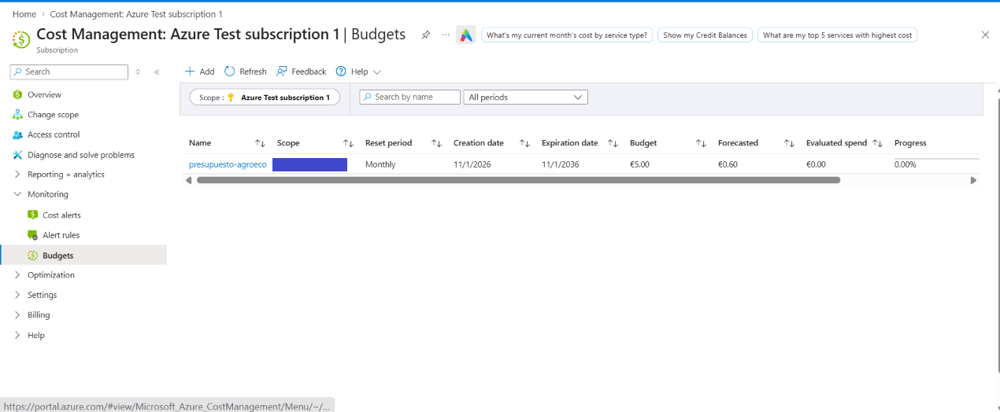

**Alertas del presupuesto.** Avisos por correo al 50 %, 80 % y 100 % del gasto real, y al 100 % del previsto.

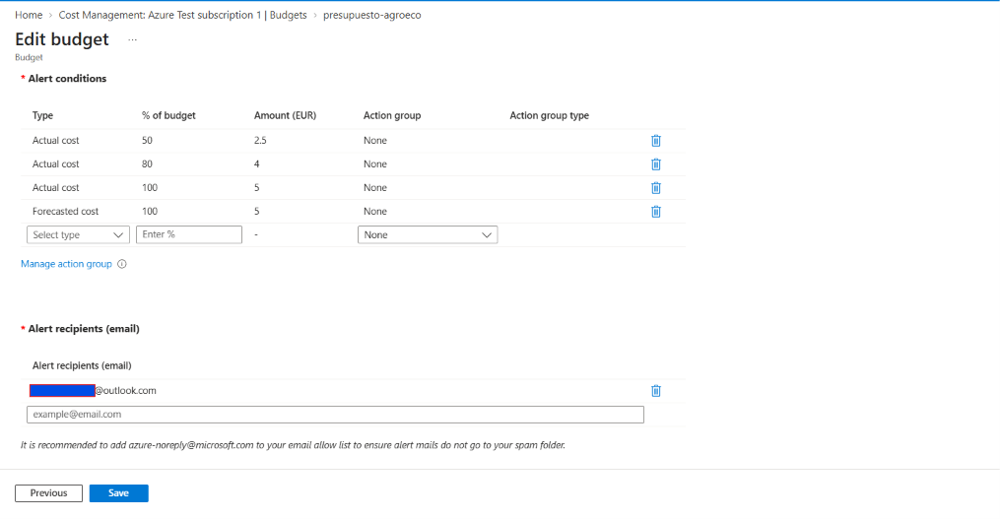

**Grupo de recursos.** Los 8 recursos que crea el Bicep: todo en Spain Central salvo el servidor y la base de datos SQL, que están en France Central.

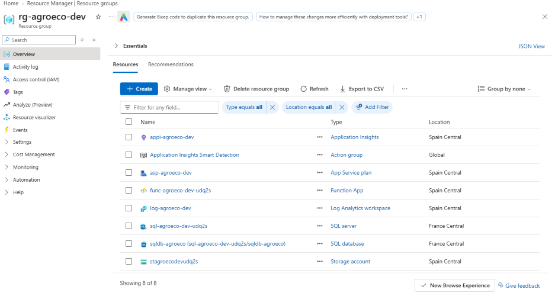

**Function App.** Las dos funciones desplegadas y activas: `pipeline_mensual` (temporizador) y `pipeline_manual` (HTTP).

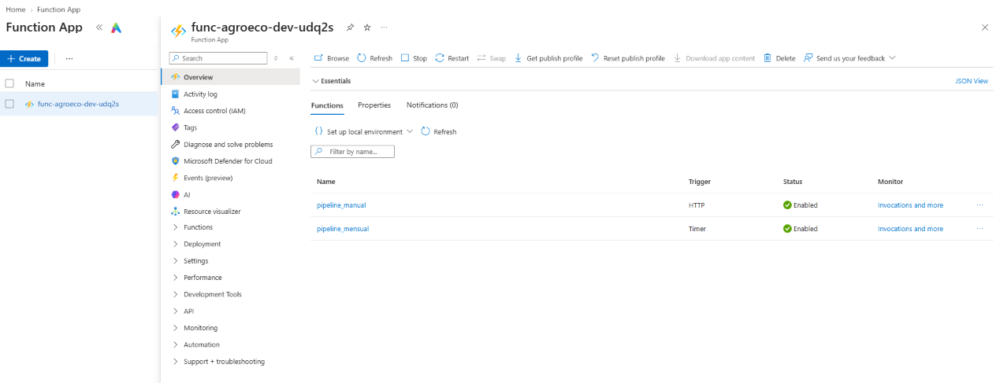

**Logs del pipeline (inicio).** Application Insights registra cada paso; aquí empieza la descarga desde Eurostat.

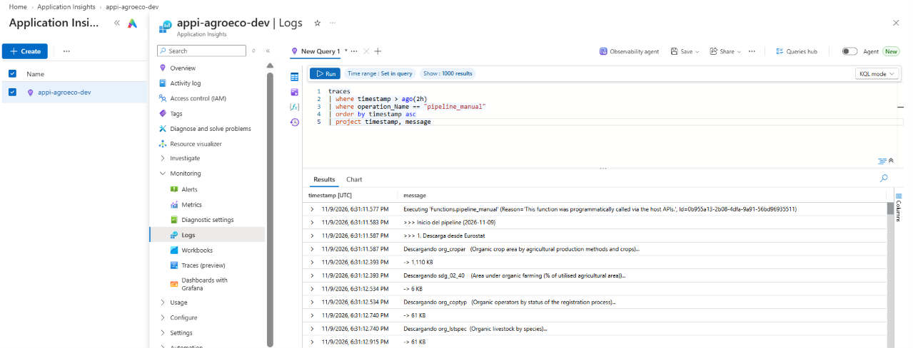

**Logs del pipeline (final).** La carga en Azure SQL termina con el número de filas de cada tabla y `Succeeded`.

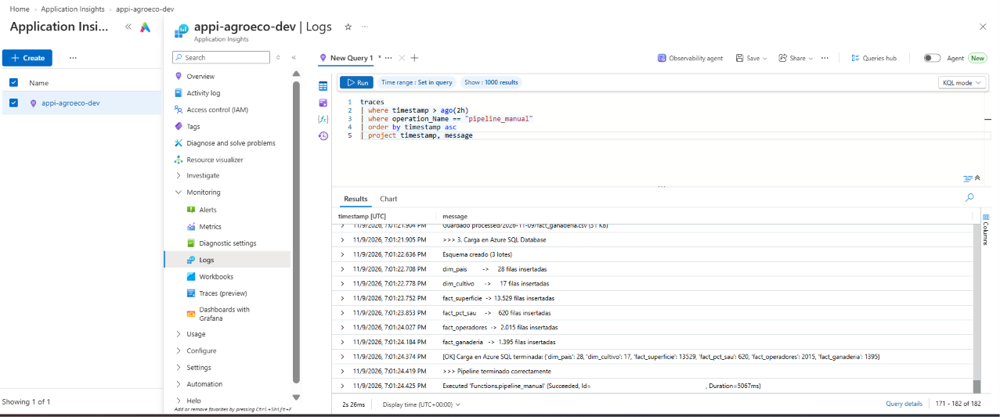

**Contenedor `raw`.** Los 4 archivos TSV originales de Eurostat y `fuente_datos.json`, guardados en una carpeta con la fecha de ejecución.

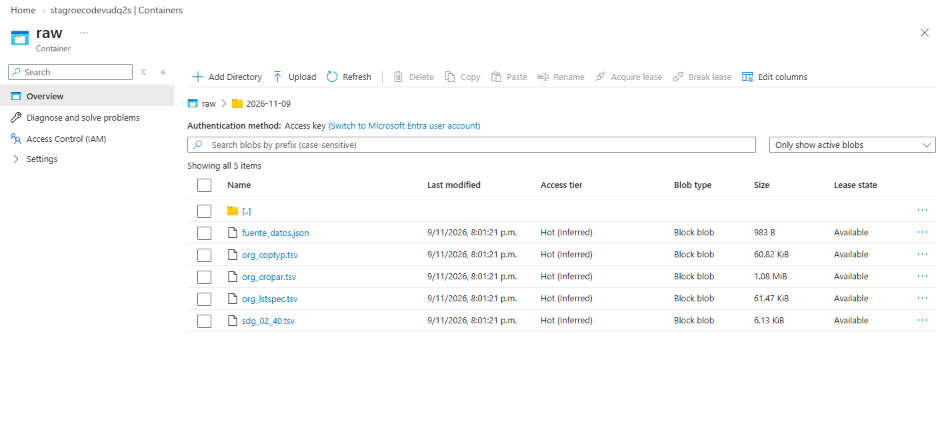

**Contenedor `processed`.** Las 6 tablas limpias del modelo en estrella, en CSV.

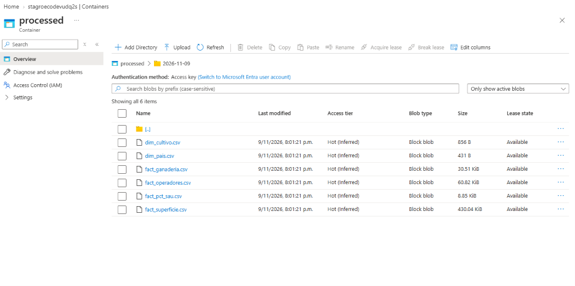

**Base de datos con la oferta gratuita.** Pricing tier *Free*, Overage billing *Disabled* (nunca cobra) y la base de datos pausada (*Paused*) cuando no se usa.

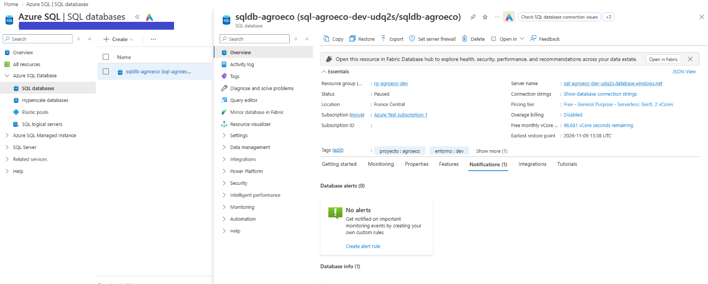

**Query editor.** La consulta `q01_evolucion_espana` en T-SQL, ejecutada en el portal contra los datos cargados.

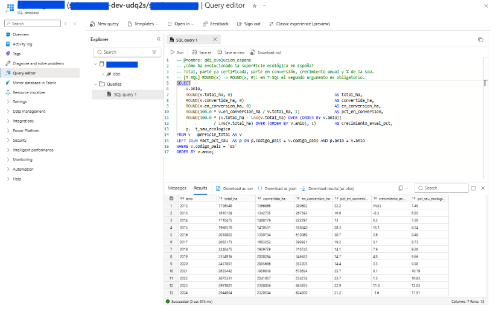

**Ejecución manual.** `ejecutar_manual.ps1` lanza el pipeline y devuelve las filas cargadas en cada tabla.

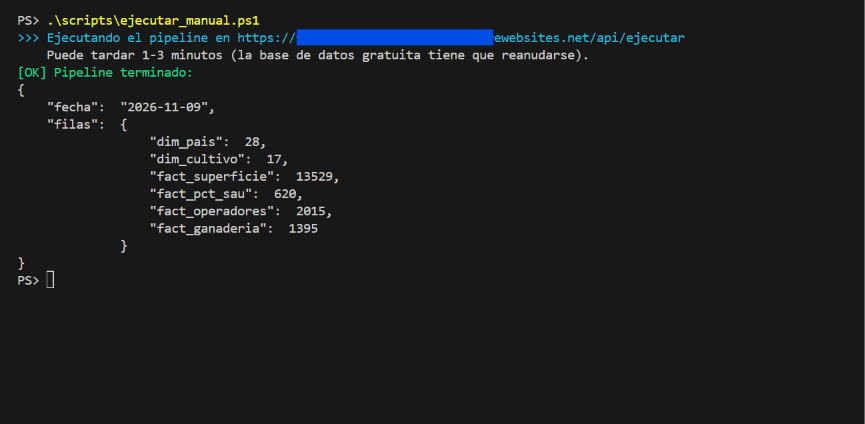

## 👤 Autor

**[Samuel Anaya Garcia]** – [LinkedIn](https://www.linkedin.com/in/samuel-anaya-garcia) · [GitHub](https://github.com/SamAnaya11)
