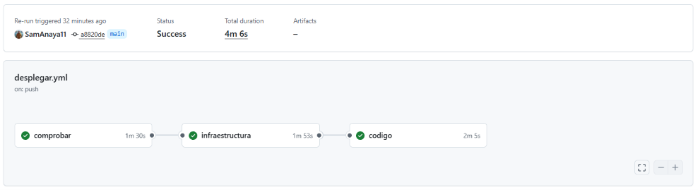
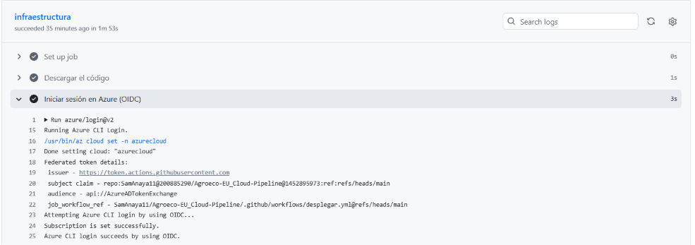
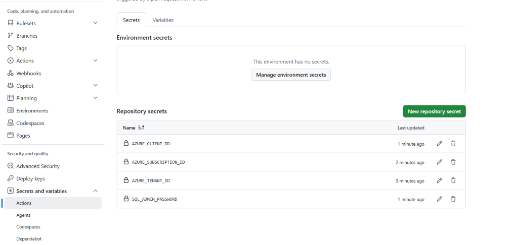
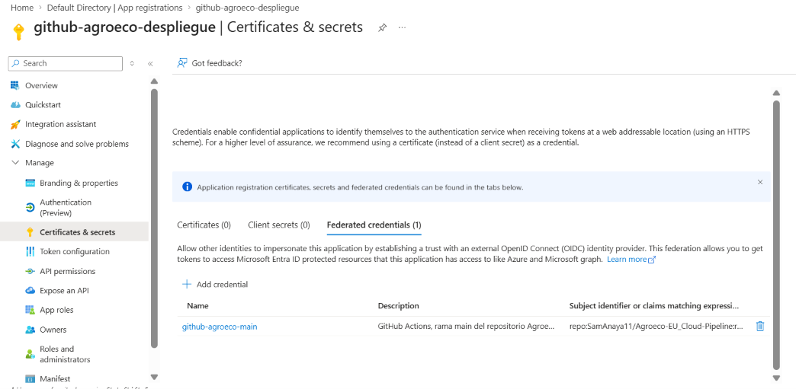
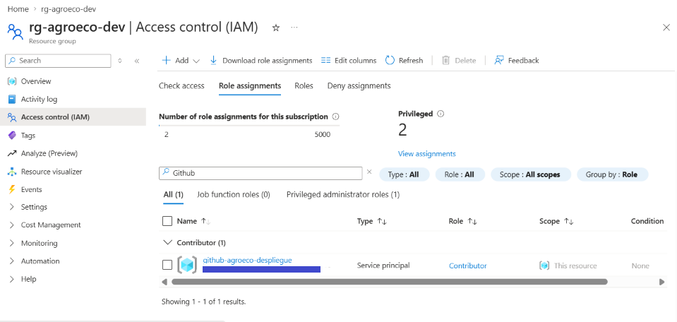
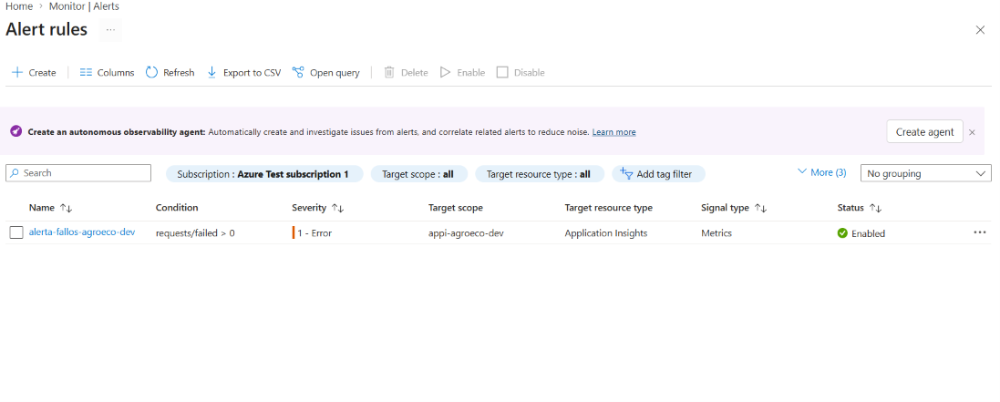
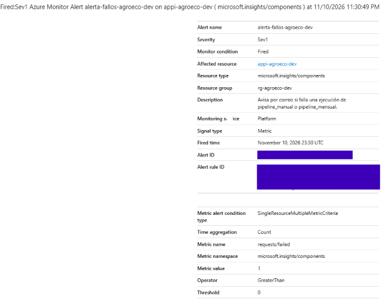
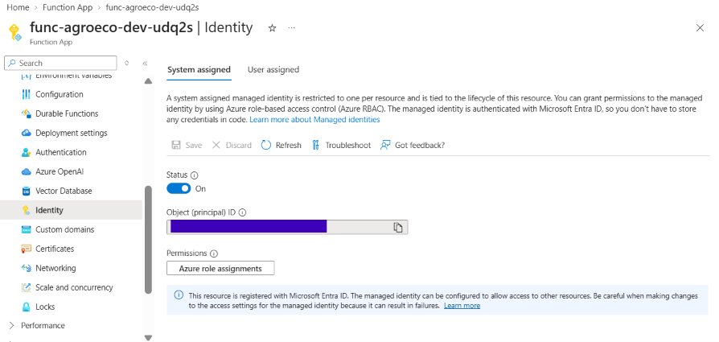
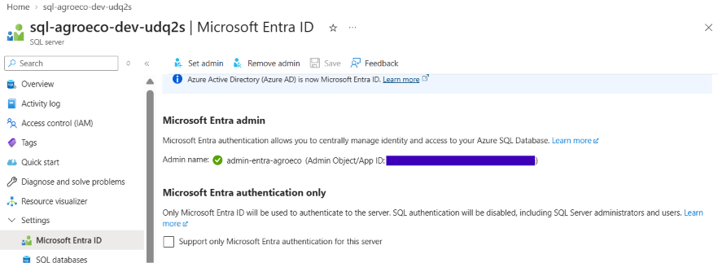
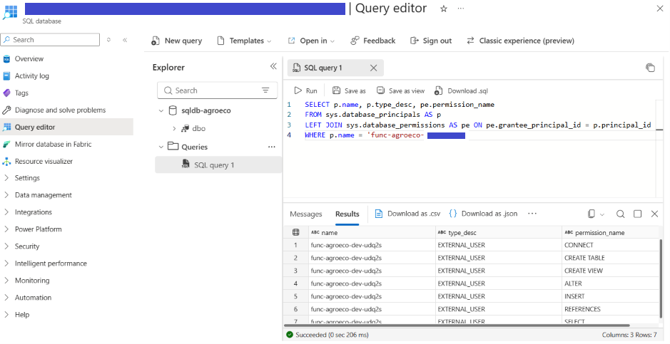

# ☁️ Agroeco EU Cloud Pipeline: agricultura ecológica en Azure

Versión en la nube del proyecto [**Agricultura Ecológica en España (2012-2024)**](https://github.com/SamAnaya11/EU-Agricultural-Data-Analysis):
el mismo análisis con datos de **Eurostat**, pero ahora el pipeline funciona **solo en Azure**. Cada mes
descarga los datos, los guarda, los limpia y los carga en una base de datos en la nube, **sin intervención manual**.

> ℹ️ **Nota:** el proyecto se desplegó con una **suscripción de prueba gratuita** de Azure. Las
> [capturas](#-capturas) documentan que el pipeline funciona de principio a fin; los recursos pueden
> borrarse en cualquier momento con [`borrar_todo`](scripts/borrar_todo.ps1) y volver a crearse con `desplegar`.

## 📌 Estado del proyecto

| Fase | Contenido | Estado |
|---|---|---|
| 0 | Análisis del original, migración SQLite → T-SQL, presupuesto de 5 € | ✅ Completada |
| 1 | Infraestructura con Bicep + Function mensual y manual + carga en Azure SQL | ✅ Completada |
| 2 | Despliegue automático con GitHub Actions (OIDC) | ✅ Completada |
| 3A | Alerta por correo si falla la Function (Azure Monitor) | ✅ Completada |
| 3B | Seguridad: la Function entra en Azure SQL con identidad administrada (sin contraseña) | ✅ Completada |

**Primera ejecución en Azure (09/11/2026):** 28 países, 17 cultivos, 13.529 filas de superficie, 620 de % SAU,
2.015 de operadores y 1.395 de ganadería. Son las mismas cifras que el proyecto original.

---

## 🎯 Objetivo

| Proyecto original (local) | Este proyecto (Azure) |
|---|---|
| Se ejecuta a mano con `python main.py` | Se ejecuta solo el **día 1 de cada mes** |
| Archivos en `data/raw/` y `data/processed/` | Contenedores `raw/` y `processed/` en **Blob Storage**, con histórico por fecha |
| Base de datos **SQLite** (un archivo `.db`) | **Azure SQL Database** (mismo modelo en estrella) |
| Consultas desde el notebook | Consultas desde el **portal** (Query editor) o desde un notebook |

## 🏗️ Arquitectura

```
 git push (main) ──> GitHub Actions: comprobar → infraestructura (Bicep) → código (.zip)
                            │
                            │ OIDC: sin contraseña guardada; rol Contributor solo sobre rg-agroeco-dev
                            v despliega
 Temporizador mensual ─┐
 (o petición POST) ────┴──> Azure Function (Python) ──> API Eurostat
                                    │
                                    ├──> Blob Storage        raw/AAAA-MM-DD/*.tsv
                                    ├──> Blob Storage        processed/AAAA-MM-DD/*.csv
                                    ├──> Azure SQL Database  modelo en estrella ──> consultas (portal / notebook)
                                    │      ↑ identidad administrada: token de Entra ID, sin contraseña
                                    │
                                    └──> Application Insights ──> alerta "requests/failed > 0" ──> correo
```

Diagrama detallado, regiones y convención de nombres: [`docs/arquitectura.md`](docs/arquitectura.md).

## 🧰 Servicios de Azure

| Servicio | Región | Para qué | Por qué este |
|---|---|---|---|
| **Azure Functions** (Flex Consumption, Python 3.14) | Spain Central | Ejecuta el pipeline | Plan de consumo **recomendado por Microsoft**; se paga por uso y tiene cuota gratuita mensual |
| **Blob Storage** (Standard LRS) | Spain Central | Guarda los datos originales y limpios | La opción de almacenamiento más barata |
| **Azure SQL Database** (oferta gratuita, serverless) | **France Central** | Modelo en estrella y consultas | Gratis para siempre (100.000 vCore·s y 32 GB al mes) y habla T-SQL |
| **Application Insights** + Log Analytics | Spain Central | Logs y errores de la Function | Integrado con Functions; 5 GB/mes gratis |
| **Azure Monitor** (alerta de métrica + Action Group) | Global | Correo si falla la Function | Alerta de métrica: 10 series temporales gratis al mes; 1.000 correos gratis al mes |
| **Microsoft Entra ID** (identidad administrada + administrador de Entra en SQL) | Global | La Function entra en SQL sin contraseña | Gratis |
| **Cost Management** (presupuesto) | Suscripción | Aviso por correo si el gasto pasa de 5 € | Gratis |

## 🚀 Despliegue paso a paso

**Requisitos:** una suscripción de Azure, [Azure CLI](https://learn.microsoft.com/cli/azure/install-azure-cli)
(incluye Bicep) y Python 3.11 o superior. Los comandos son de PowerShell; en Linux/macOS hay scripts `.sh` equivalentes.

**1. Iniciar sesión**

```powershell
az login
```

**2. Crear el presupuesto de 5 €** (gratis). Hazlo antes que cualquier otro recurso:

```powershell
az deployment sub create --name presupuesto-agroeco --location spaincentral `
  --template-file infra/presupuesto.bicep --parameters correoAviso=<tu correo>
```

**3. Vista previa** (what-if). No crea nada, solo muestra qué se va a crear:

```powershell
$MiIp = Invoke-RestMethod https://api.ipify.org     # tu IP pública, para el firewall de SQL
.\scripts\desplegar.ps1 -VistaPrevia -IpCliente $MiIp
```

**4. Desplegar** la infraestructura y el código (unos 10 minutos). Azure CLI te pide la contraseña del
administrador SQL, que no se guarda en ningún archivo. El script te nombra además **administrador de Microsoft
Entra** del servidor SQL (lee tu usuario de `az login`):

```powershell
.\scripts\desplegar.ps1 -IpCliente $MiIp
```

**4b. Solo la primera vez: crear el usuario de la Function en SQL.** En el Query editor, con *Microsoft Entra
authentication*, ejecuta `sql/03_usuario_identidad.sql` (ver [`docs/identidad_sql.md`](docs/identidad_sql.md)).
Sin este paso, la Function no puede entrar en la base de datos.

Si solo cambias código de Python, basta con `.\scripts\desplegar.ps1 -SoloCodigo`.

**5. Ejecutar el pipeline** sin esperar al día 1 del mes:

```powershell
.\scripts\ejecutar_manual.ps1
```

**6. Comprobarlo en el portal:**

| Dónde | Qué ver |
|---|---|
| Resource groups → `rg-agroeco-dev` | Todos los recursos del proyecto (Storage, Function, SQL, Application Insights, alerta...) |
| Function App → Overview → Functions | `pipeline_mensual` (Timer) y `pipeline_manual` (HTTP) |
| Storage account → Containers → `raw` / `processed` | Una carpeta por fecha de ejecución |
| SQL database → Query editor (preview) | Las consultas de `sql/02_consultas_analisis.sql` |
| Application Insights → Logs | Los mensajes del pipeline (tabla `traces`) |

### ▶️ Ejecutar manualmente

El script hace esto (solo lee datos de Azure; no crea nada):

```powershell
$App   = az deployment sub show --name agroeco-dev --query properties.outputs.functionApp.value -o tsv
# Flex Consumption: el host está en "properties.defaultHostName" (el campo de primer nivel sale vacío)
$Host_ = az functionapp show -g rg-agroeco-dev -n $App --query properties.defaultHostName -o tsv
$Clave = az functionapp function keys list -g rg-agroeco-dev -n $App --function-name pipeline_manual --query default -o tsv
Invoke-RestMethod -Method Post -Uri "https://$Host_/api/ejecutar?code=$Clave" -TimeoutSec 300
```

También vale el **Default domain** que muestra el portal (Function App → Overview).

⚠️ **OneDrive:** crea el entorno virtual **fuera** de OneDrive (por ejemplo en `%LOCALAPPDATA%\venvs\agroeco`).

## 🔁 CI/CD con GitHub Actions

Después del primer despliegue desde tu ordenador, **cada `push` a `main` despliega solo**
([`.github/workflows/desplegar.yml`](.github/workflows/desplegar.yml)). También se puede lanzar a mano desde la
pestaña **Actions → Desplegar en Azure → Run workflow**.

```
 git push (main) ──> 1. comprobar ─────────> 2. infraestructura ───────────> 3. código
                     · compila el Bicep      · solo si cambia infra/         · empaquetar.py
                     · crea el paquete       · az deployment group create    · config-zip (remote build)
                     · importa la Function
```

| Trabajo | Qué hace | ¿Se conecta a Azure? |
|---|---|---|
| `comprobar` | Compila el Bicep, crea el paquete con `empaquetar.py` e importa la Function para ver que encuentra `pipeline_mensual` y `pipeline_manual` | No |
| `infraestructura` | Despliega `infra/modulos/recursos.bicep` en el grupo de recursos. Solo si ha cambiado algo en `infra/` (o si se marca la casilla al lanzarlo a mano) | Sí |
| `codigo` | Sube el código a la Function App, igual que `desplegar.ps1 -SoloCodigo` | Sí |

Los cambios que solo tocan documentación (`*.md`, `docs/`) **no** lanzan el workflow.

**Inicio de sesión sin contraseñas (OIDC):** GitHub no guarda ninguna clave de Azure. Azure confía en los tokens
que GitHub firma para **este repositorio y la rama `main`**, y GitHub solo tiene el rol **Contributor sobre
`rg-agroeco-dev`**. Explicación completa, comandos para crear la identidad y errores típicos:
[`docs/cicd_oidc.md`](docs/cicd_oidc.md).

**Secretos de GitHub** (*Settings → Secrets and variables → Actions → New repository secret*):

| Secreto | Valor | De dónde sale |
|---|---|---|
| `AZURE_CLIENT_ID` | ID de la aplicación de Entra ID | `$AppId` (`az ad app create ... --query appId`) |
| `AZURE_TENANT_ID` | ID del directorio | `az account show --query tenantId -o tsv` |
| `AZURE_SUBSCRIPTION_ID` | ID de la suscripción | `az account show --query id -o tsv` |
| `SQL_ADMIN_PASSWORD` | Contraseña del administrador SQL | La que usaste en `desplegar.ps1` |
| `ALERTAS_CORREO` *(opcional)* | Correo que recibe la alerta si falla la Function | El tuyo. Sin este secreto, el workflow no crea ni borra la alerta |
| `SQL_ADMIN_ENTRA_ID` *(opcional)* | Object ID de tu usuario (administrador de Entra del servidor SQL) | `az ad signed-in-user show --query id -o tsv`. Sin este secreto, el workflow no toca el administrador que ya existe |

**Coste:** 0 €. GitHub Actions es gratis en repositorios públicos.

## 🚨 Alerta si falla la Function

Si `pipeline_mensual` o `pipeline_manual` fallan, llega un **correo** en unos 5-10 minutos:

```
 Function falla ──> Application Insights ──> alerta-fallos-agroeco-dev ──> ag-agroeco-dev ──> 📧
                    (request fallida)        "requests/failed > 0"         (Action Group)
```

- **Alerta de métrica**, no de logs: es **gratis** (1 serie temporal; Azure Monitor incluye 10 al mes) y los
  primeros 1.000 correos al mes también.
- El correo **no está en el repositorio**: se pasa al desplegar con `-CorreoAlertas` o con el secreto de
  GitHub `ALERTAS_CORREO`. Sin correo, no se crea la alerta.
- Se prueba con un **fallo controlado** (variable `PRUEBA_ALERTA=1`) que después se deshace. Probada el
  10/11/2026: el correo *Fired: Sev1* llegó con `Metric value 1` (ver [Capturas](#-capturas)).

Detalles, permisos y cómo probarla paso a paso: [`docs/alertas.md`](docs/alertas.md).

## 🪪 Azure SQL sin contraseña (identidad administrada)

La Function entra en Azure SQL con su **identidad administrada**, no con el usuario y la contraseña del
administrador:

```
 Function App ──token de Entra ID (~1 h)──> Azure SQL ──> usuario [func-agroeco-dev-XXXXX] con permisos mínimos
 SQL_CADENA_CONEXION = ...;Authentication=ActiveDirectoryMSI;...        (sin UID ni PWD)
```

- **Bicep:** identidad *system-assigned* en la Function App y tu usuario como **administrador de Microsoft
  Entra** del servidor SQL.
- **Base de datos:** un usuario para la identidad (`sql/03_usuario_identidad.sql`), con solo `CREATE TABLE`,
  `CREATE VIEW` y `ALTER`, `REFERENCES`, `INSERT`, `SELECT` sobre el esquema `dbo`. Ya no es el administrador.
- **Sin asignaciones de roles:** los permisos se dan con T-SQL, así que GitHub sigue teniendo solo *Contributor*.
- **En local:** `Authentication=ActiveDirectoryDefault` (tu `az login`) o, como acceso de emergencia, el
  usuario SQL (ver `.env.example`).
- **Coste:** 0 €.
- El usuario SQL con contraseña **se mantiene** como acceso de emergencia, y la regla `AllowAllWindowsAzureIps`
  también: la Function no tiene IP fija, y la red virtual con *service endpoint* exige que la Function y SQL
  estén en la misma región.

Probada el 11/11/2026: `ejecutar_manual.ps1` cargó las mismas filas (28 / 17 / 13.529 / 620 / 2.015 / 1.395)
con la identidad administrada. Ver [Capturas](#-capturas).

Limitaciones con una cuenta personal, pasos, plan B y errores típicos:
[`docs/identidad_sql.md`](docs/identidad_sql.md).

## 💶 Costes estimados

| Recurso | Coste mensual estimado |
|---|---:|
| Function App (Flex Consumption) | 0 € (dentro de la cuota gratuita) |
| Azure SQL Database (oferta gratuita, AutoPause) | 0 € |
| Storage Account (pocos MB) | < 0,01 € |
| Application Insights / Log Analytics | 0 € (tope de 0,1 GB/día) |
| Tráfico Spain Central → France Central (~2 MB) | ≈ 0 € |
| Alerta de fallos (métrica, 1 serie temporal) + correos | 0 € (dentro de la cuota gratuita) |
| Identidad administrada + administrador de Entra en SQL | 0 € |
| **Total** | **≈ 0 €** (céntimos) |

## 🗑️ Borrarlo todo

```powershell
.\scripts\borrar_todo.ps1
```

Pide confirmación y elimina el grupo de recursos completo. El presupuesto (gratis) se mantiene.

## 🧠 Decisiones técnicas

### 1. Azure SQL en France Central (y el resto en Spain Central)

Todo el proyecto está en **Spain Central** (la región más cercana), salvo el **servidor y la base de datos SQL**,
que están en **France Central**.

**Por qué:** la oferta gratuita de Azure SQL Database **no está disponible en Spain Central para esta
suscripción de prueba** (*Free Trial*). Al desplegar, Azure respondía:

```
ProvisioningDisabled: Provisioning of free limit database is not supported
for provided service level objective or region
```

**Cómo se comprobó:** el error se repetía con cualquier forma de escribir el SKU, así que se consultó la API de
capacidades de Azure SQL de cada región (solo lectura). En Spain Central el SKU serverless `GP_S_Gen5_2` está
disponible **de pago**, pero sin la opción de límite gratuito (`supportedFreeLimitExhaustionBehaviors`):

| Región | ¿Se puede crear SQL? | ¿Oferta gratuita? |
|---|---|---|
| Spain Central | ✅ | ❌ |
| **France Central** | ✅ | ✅ ← elegida (la más cercana) |
| Sweden Central, Germany West Central, Italy North, Poland Central | ✅ | ✅ |
| North Europe, West Europe | ⛔ restringidas para esta suscripción | — |

**Qué implica:**
- El servidor SQL y su base de datos tienen que estar **en la misma región**; por eso los dos usan el
  parámetro `ubicacionSql` del Bicep.
- La Function (España) se conecta a la base de datos (Francia): unos 20-30 ms más por consulta, inapreciable
  en una carga mensual de ~17.600 filas.
- El tráfico entre regiones es de unos pocos MB al mes: coste prácticamente nulo.
- Si en el futuro la oferta gratuita llega a Spain Central, basta con cambiar `ubicacionSql` en
  `infra/main.parameters.example.json` (habría que borrar y recrear el servidor SQL).

### 2. SQLite → Azure SQL Database (T-SQL)

| | SQLite (original) | Azure SQL Database |
|---|---|---|
| Dónde vive | Un archivo `.db` en el ordenador | Un servidor en la nube |
| Acceso | Solo desde ese ordenador | Desde la Function, el portal o un notebook |
| Coste | Gratis | Gratis (oferta gratuita) |
| Dialecto | SQL de SQLite | T-SQL (`TOP` en vez de `LIMIT`, `ROUND(x, 0)`, `NVARCHAR`...) |

El modelo en estrella es idéntico. Las diferencias de sintaxis y los cambios en cada una de las 10 consultas
están en [`docs/migracion_sqlite_a_tsql.md`](docs/migracion_sqlite_a_tsql.md).

### 3. Flex Consumption en lugar del plan de consumo clásico

El plan de consumo clásico en Linux deja de existir el **30/09/2028** y ya no recibe versiones nuevas de Python.
Flex Consumption es el plan sin servidor recomendado por Microsoft, también de pago por uso. Se limita a
**1 instancia** como máximo para que el coste nunca se dispare.

### 4. Driver `mssql-python`

Es el driver oficial de Microsoft para Python e **incluye el driver ODBC** dentro del paquete de pip, así que
no hay que instalar nada en el sistema. Además admite identidad administrada (`Authentication=ActiveDirectoryMSI`,
con la librería `azure-identity`), que es como se conecta la Function desde la Fase 3B.

La cadena de conexión solo puede llevar las palabras clave que admite el driver (`Server`, `Database`,
`UID`, `PWD`, `Encrypt`, `TrustServerCertificate`...). **`Connection Timeout` no es válida** (da
`ConnectionStringParseError`): el tiempo de espera se pasa en el código con `connect(..., timeout=60)`.

### 5. Carga completa en una transacción

Cada mes se borran y se vuelven a crear las tablas (como en el original), pero **todo en una transacción**:
si algo falla, se deshace y la base de datos conserva los datos del mes anterior.

### 6. Secretos y seguridad

**Secretos fuera del repositorio.** La contraseña de SQL la pide Azure CLI al desplegar y solo la usa el
servidor SQL. Desde la Fase 3B, la Function ya **no** la tiene: entra con su identidad administrada.
`.env`, `local.settings.json` y los parámetros locales están en `.gitignore`.

**Firewall de SQL: regla `AllowAllWindowsAzureIps` (0.0.0.0).** Una Function App en Flex Consumption no
tiene una IP fija, así que no se puede abrir el firewall solo para ella. La regla especial `0.0.0.0` equivale a la
opción del portal *"Allow Azure services and resources to access this server"*:

| | |
|---|---|
| ✅ Permite | Conexiones desde **cualquier servicio de Azure**: la Function y también el Query editor del portal |
| ⚠️ Ojo | "Cualquier servicio de Azure" incluye recursos de **otros clientes** de Azure, no solo los de esta suscripción |
| 🔒 Lo que sigue protegiendo | Para entrar hace falta un token de Microsoft Entra de una identidad con usuario en la base de datos (como la Function) o la contraseña del administrador SQL, que ya no está en la Function. La conexión va cifrada (TLS 1.2) |
| 🌐 Desde Internet | Bloqueado, salvo la IP que se pasa con `-IpCliente` (regla `ip-cliente`) |

Es una configuración aceptable para un proyecto de pruebas con datos públicos, pero no la ideal. En la
**Fase 3B**, la Function pasa a autenticarse con su **identidad administrada**, así que la contraseña del
administrador ya no está en su configuración. La regla 0.0.0.0 **se mantiene**, porque la identidad cambia
*cómo* se entra, no *desde dónde*:

- un *service endpoint* (gratis) exige que la red virtual y SQL estén en la misma región, y aquí son Spain Central
  y France Central;
- un *private endpoint* **sí tiene coste** (unos 7 €/mes), así que queda como mejora opcional.

Ver [`docs/identidad_sql.md`](docs/identidad_sql.md#-se-puede-quitar-la-regla-de-firewall-allowallwindowsazureips).

## 🧩 Problemas encontrados y cómo se resolvieron

| Problema | Causa | Solución |
|---|---|---|
| `SubscriptionNotFound: The requested subscription ... was not found` en el primer despliegue | La suscripción existía, pero los **proveedores de recursos** (`Microsoft.Sql`, `Microsoft.Insights`, `Microsoft.OperationalInsights`) no estaban registrados en una suscripción nueva | Registrarlos con `az provider register --namespace <proveedor> --wait` (gratis). `desplegar.ps1` y `desplegar.sh` lo hacen ahora en el paso 2 |
| `PasswordNotComplex` al crear el servidor SQL | Azure SQL exige una contraseña compleja: mayúsculas, minúsculas, números y símbolos, y que no contenga el nombre de usuario | Usar una contraseña que cumpla las reglas. El Bicep pide además un mínimo de 12 caracteres, y se evitan `;` `{` `}` para no romper la cadena de conexión |
| `ProvisioningDisabled` al crear la base de datos gratuita | La oferta gratuita de Azure SQL no está disponible en Spain Central para la suscripción de prueba | Comprobarlo con la API de capacidades de SQL y mover solo SQL a **France Central** (parámetro `ubicacionSql`). Ver [Decisiones técnicas](#1-azure-sql-en-france-central-y-el-resto-en-spain-central) |
| `ConnectionStringParseError: "connection timeout" is not a recognized keyword` | El driver `mssql-python` solo admite una lista cerrada de palabras clave en la cadena de conexión | Quitar `Connection Timeout` de la cadena y pasar el tiempo de espera en el código: `connect(..., timeout=60)` |
| Host vacío al leer la URL de la Function con Azure CLI | En Flex Consumption, `az functionapp show --query defaultHostName` devuelve vacío | Leer `properties.defaultHostName`. Los scripts `ejecutar_manual` y la salida `hostFunction` del Bicep ya lo hacen así |
| El what-if quería **borrar** la etiqueta `hidden-link: /app-insights-resource-id` de la Function App | El portal añade esa etiqueta por su cuenta para enlazar la Function con Application Insights. Como el Bicep no la declaraba, cada despliegue la habría quitado | Declararla en el Bicep junto a las etiquetas comunes: `tags: union(etiquetas, { 'hidden-link: /app-insights-resource-id': appInsights.id })` |
| GitHub (rol Contributor sobre el grupo) no podía desplegar `infra/main.bicep` | `main.bicep` es un despliegue de **suscripción** (crea el grupo de recursos), y GitHub solo tiene permisos **dentro** del grupo | GitHub despliega directamente `infra/modulos/recursos.bicep` con `az deployment group create`. El módulo calcula él mismo el sufijo y las etiquetas, así que los nombres son idénticos se despliegue de una forma u otra. Ver [`docs/cicd_oidc.md`](docs/cicd_oidc.md) |
| `AADSTS700213: No matching federated identity record found` al iniciar sesión desde GitHub Actions | GitHub envió el *subject* con **IDs inmutables** (`repo:SamAnaya11@200885290/Agroeco-EU_Cloud-Pipeline@1452895973:ref:refs/heads/main`) y la credencial federada esperaba el formato clásico, sin IDs | Copiar el *subject* exacto del mensaje de error y crear una segunda credencial federada (escenario *Other issuer*) con ese valor: `scripts/credencial_federada_ids.json`. Después, *Re-run failed jobs*. Ver [`docs/cicd_oidc.md`](docs/cicd_oidc.md#aadsts700213-el-subject-con-ids-inmutables) |
| La alerta no habría visto los fallos de `pipeline_manual` | La función capturaba el error y devolvía un 500 "controlado". Para Azure, la ejecución terminaba bien, así que no contaba en la métrica `requests/failed` | Registrar el error con `logging.exception` y **volver a lanzarlo** (`raise`), igual que `pipeline_mensual`. Comprobado con el fallo de prueba `PRUEBA_ALERTA=1`. Ver [`docs/alertas.md`](docs/alertas.md#cambio-en-pipeline_manual) |
| El what-if no mostraba `identity.type: SystemAssigned` en la Function App | El what-if no siempre enseña todos los cambios de un recurso: es una vista previa, no una garantía | Desplegar igualmente y **comprobar el resultado real** con `az functionapp identity show -g rg-agroeco-dev -n <function> --query type -o tsv` (devuelve `SystemAssigned`). Ver [`docs/identidad_sql.md`](docs/identidad_sql.md#-pasos-en-este-orden) |
| `CREATE USER ... FROM EXTERNAL PROVIDER` no funciona conectado con el usuario SQL | SQL busca la identidad en Microsoft Entra ID **en nombre de quien ejecuta el comando**. Con el usuario SQL (usuario y contraseña) no hay ninguna identidad de Entra con la que buscarla | En el Query editor, entrar con **Microsoft Entra authentication** (*Continue as ...*) como administrador de Entra del servidor, y ejecutar ahí `sql/03_usuario_identidad.sql` |

## 🔮 Posibles mejoras

| Mejora | Qué aporta | Qué exige | Coste |
|---|---|---|---|
| **Storage con identidad administrada** | La Function deja de usar la clave de la Storage Account: ya no queda **ningún secreto** en su configuración | **Asignaciones de roles** para la identidad (*Storage Blob Data Owner*, *Storage Queue Data Contributor*, *Storage Table Data Contributor*). GitHub necesitaría además *Role Based Access Control Administrator* con una condición que solo le deje asignar esos roles | 0 € |
| **Cerrar la red de SQL con un *private endpoint*** | Quitar la regla `AllowAllWindowsAzureIps`: SQL solo sería accesible desde la red virtual del proyecto | Integración de la Function con una red virtual, un *private endpoint* para SQL y una zona DNS privada. Un *service endpoint* (gratis) no sirve, porque exige la misma región y aquí son Spain Central y France Central | **Unos 7 €/mes** |
| **Activar *Microsoft Entra authentication only*** | Desactiva del todo el usuario SQL con contraseña: solo se entra con identidades de Entra | Hacerlo cuando todo funcione con Entra. Dejarían de funcionar la opción B del `.env` y el inicio de sesión con usuario SQL del Query editor | 0 € |

## 📁 Estructura del proyecto

```
├── .github/workflows/  # desplegar.yml: CI/CD con GitHub Actions
├── infra/            # Bicep: main.bicep, modulos/recursos.bicep, presupuesto.bicep, parámetros de ejemplo
├── function_app/     # Azure Function (timer + HTTP), host.json, requirements.txt
├── src/              # Descarga, limpieza, almacenamiento, carga SQL y orquestador
├── sql/              # Esquema, 10 consultas en T-SQL y usuario de la identidad administrada
├── scripts/          # desplegar / ejecutar_manual / borrar_todo (.ps1 y .sh), empaquetar.py, credenciales federadas (.json)
├── notebooks/        # Consultas contra Azure SQL
├── docs/             # arquitectura.md, migracion_sqlite_a_tsql.md, cicd_oidc.md, alertas.md, identidad_sql.md, capturas/
├── .env.example      # Plantilla del .env para ejecutar en local (sin valores reales)
├── requirements-local.txt  # Dependencias para tu ordenador (pipeline y notebook)
└── README.md
```

## 📸 Capturas

**Presupuesto de 5 €.** El aviso de gasto está creado antes que cualquier otro recurso.


**Alertas del presupuesto.** Avisos por correo al 50 %, 80 % y 100 % del gasto real, y al 100 % del previsto.


**Grupo de recursos.** Los recursos de la Fase 1 que crea el Bicep: todo en Spain Central salvo el servidor y la base de datos SQL, que están en France Central.


**Function App.** Las dos funciones desplegadas y activas: `pipeline_mensual` (temporizador) y `pipeline_manual` (HTTP).


**Logs del pipeline (inicio).** Application Insights registra cada paso; aquí empieza la descarga desde Eurostat.


**Logs del pipeline (final).** La carga en Azure SQL termina con el número de filas de cada tabla y `Succeeded`.


**Contenedor `raw`.** Los 4 archivos TSV originales de Eurostat y `fuente_datos.json`, guardados en una carpeta con la fecha de ejecución.


**Contenedor `processed`.** Las 6 tablas limpias del modelo en estrella, en CSV.


**Base de datos con la oferta gratuita.** Pricing tier *Free*, Overage billing *Disabled* (nunca cobra) y la base de datos pausada (*Paused*) cuando no se usa.


**Query editor.** La consulta `q01_evolucion_espana` en T-SQL, ejecutada en el portal contra los datos cargados.


**Ejecución manual.** `ejecutar_manual.ps1` lanza el pipeline y devuelve las filas cargadas en cada tabla.


**Workflow de GitHub Actions.** Despliegue automático tras un push a `main`: `comprobar`, `infraestructura` y `codigo` en verde, en unos 4 minutos.



**Inicio de sesión OIDC.** GitHub entra en Azure sin contraseña; en el log se ve el *subject* con IDs inmutables que tiene que coincidir con la credencial federada.



**Secretos de GitHub Actions.** Los 4 secretos obligatorios del workflow (los opcionales `ALERTAS_CORREO` y `SQL_ADMIN_ENTRA_ID` se añadieron después, en la Fase 3). GitHub nunca vuelve a mostrar su valor, solo el nombre.



**Credencial federada (OIDC).** La aplicación `github-agroeco-despliegue` confía en la rama `main` de este repositorio y no tiene ningún *client secret* (*Client secrets (0)*).



**Permisos de GitHub en Azure.** La identidad de GitHub solo tiene el rol *Contributor* sobre `rg-agroeco-dev` (*This resource*), no sobre toda la suscripción.



**Regla de alerta.** `alerta-fallos-agroeco-dev` vigila la métrica `requests/failed > 0` de Application Insights (*Signal type: Metrics*), con severidad *1 - Error* y activa (*Enabled*).



**Correo de la alerta.** El fallo de prueba (`PRUEBA_ALERTA=1`) hizo saltar la alerta: *Monitor condition: Fired* y *Metric value: 1*. Los identificadores de la alerta están tapados.



**Identidad administrada de la Function.** *Identity → System assigned* con *Status: On*: Azure ha creado una identidad de Microsoft Entra para `func-agroeco-dev-udq2s`, sin contraseña que guardar. El *Object ID* está tapado.



**Administrador de Entra del servidor SQL.** El servidor tiene como administrador de Microsoft Entra a `admin-entra-agroeco` (tu usuario), creado por el Bicep. El usuario SQL con contraseña sigue activo como acceso de emergencia (*Entra authentication only* sin marcar).



**Usuario de la identidad en la base de datos.** En el Query editor con Microsoft Entra authentication: `func-agroeco-dev-udq2s` es un `EXTERNAL_USER` con 7 permisos (`CONNECT` y los 6 mínimos que necesita el pipeline).



## 👤 Autor

**Samuel Anaya Garcia** – [LinkedIn](https://www.linkedin.com/in/samuel-anaya-garcia) · [GitHub](https://github.com/SamAnaya11)
